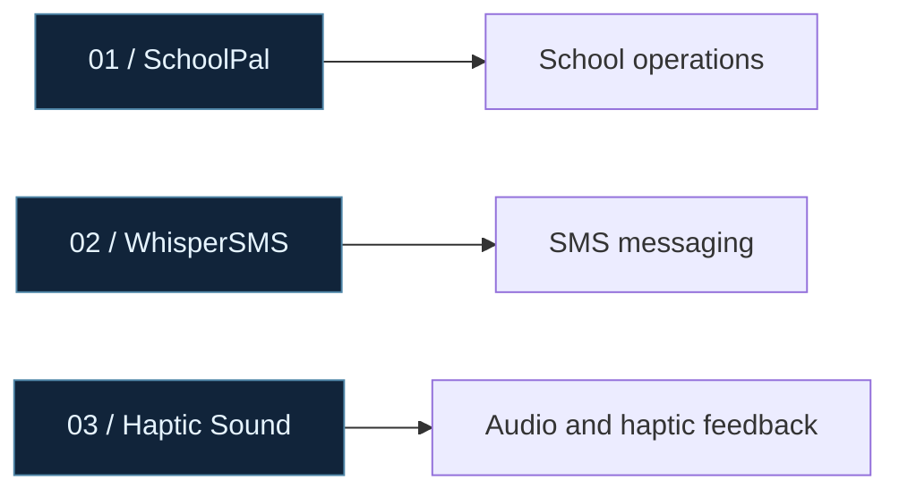

# Martin Osei Boakye

**Full-stack web and mobile developer** · Computer Science at KNUST · Ghana

I build software for school administration, messaging, and mobile experiences.

[LinkedIn](https://www.linkedin.com/in/martinoseiboakye/) · [Email](mailto:martinosb2023@gmail.com)

## Featured projects

### 01 · SchoolPal

A school management platform built for Ghanaian schools. It brings together automated report cards, fee collection via Mobile Money, and SMS updates for parents. The public walkthrough shows how the office, teacher, parent, and student portals work.

[Live site and walkthrough](https://www.schoolpal.app/)

### 02 · WhisperSMS

A mobile project focused on SMS messaging.

### 03 · Haptic Sound

A Kotlin Android app that pairs music with haptic feedback.

[Source code and setup](https://github.com/Martinosb/HAPTIC-SOUND)

## Technologies

| Area | Tools |
| --- | --- |
| Web | TypeScript, JavaScript, React, Next.js, Tailwind CSS |
| Mobile | React Native, Expo, Kotlin |
| Backend and data | Node.js, PostgreSQL |
